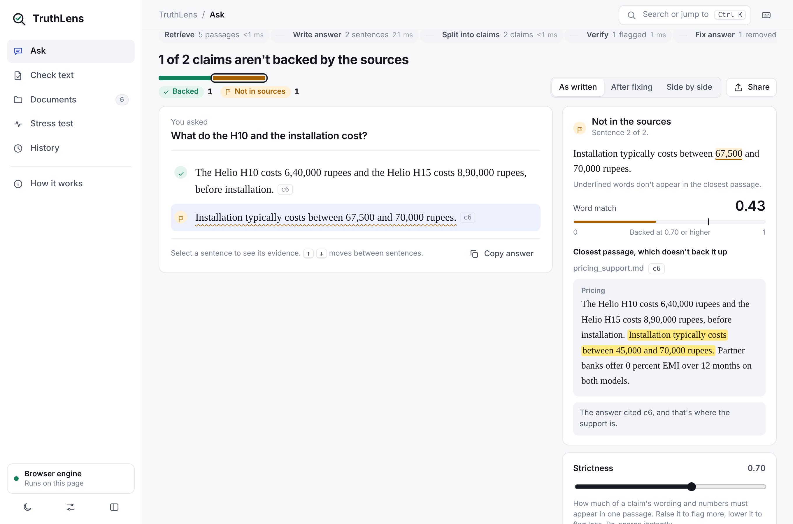
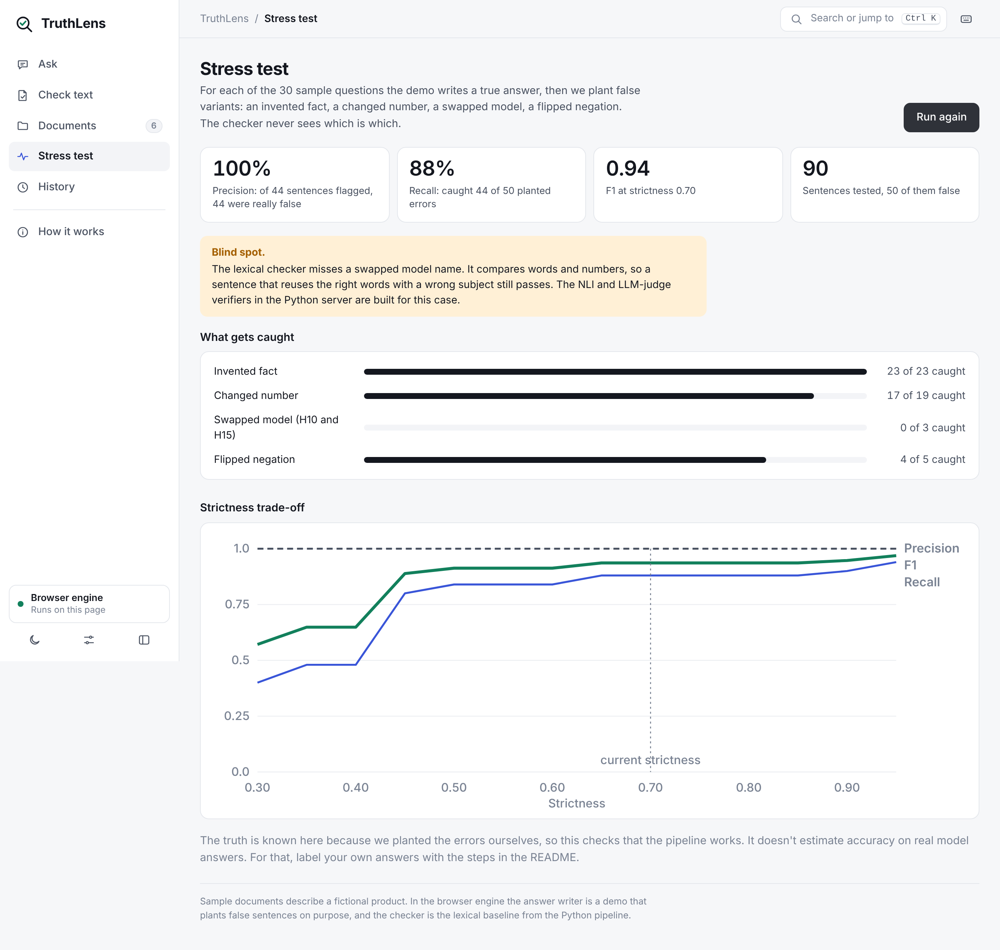
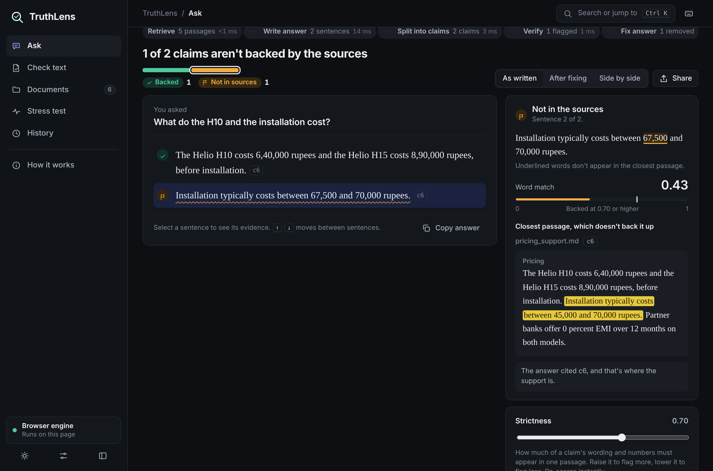

# TruthLens: citation-verified RAG with a hallucination detector

A RAG pipeline that forces the model to cite a source for every sentence, splits the answer into
atomic claims, verifies **each claim** against the retrieved text, flags (or removes, or regenerates)
the ones the sources do not support, and measures how well that works on hand-labelled answers.



Click any sentence to see the passage behind it, the verifier's score against its threshold, and whether the
answer cited the right source. Switch to **After verification** to see what was removed.

<p>
  
  
</p>

```
question ──► retrieve top-k chunks (BM25 [+ dense + rerank], stable ids c0, c1, ...)
         ──► generate answer, one [cN] citation per sentence
         ──► split into atomic claims (rules, or an LLM), each mapped back to its sentence
         ──► verify every claim against its cited chunk, falling back to all retrieved chunks
                 lexical (baseline) │ embedding (baseline) │ NLI (DeBERTa-v3) │ LLM judge
         ──► flag │ remove flagged sentences │ regenerate, then remove what is still flagged
```

**Status: the code is built and tested; no results are reported here.** Precision, recall and the
reduction in unsupported claims only exist once you run the system on your own labelled answers
(protocol below). The sample corpus is a fictional product, and the `mock` backend that runs without
an API key injects fake hallucinations, so numbers from it only prove the plumbing works.

## The web app

Open `dist/truthlens.html` in any browser, or run `python server.py`. Both give you the same app:

- **Ask**: type a question, get a cited answer, and see each sentence marked backed, not in the sources, or contradicted. Select a sentence to see the passage behind it, the words the evidence lacks, and whether the citation points at the right passage.
- **Check text**: paste any answer from any tool and check it against your documents.
- **Documents**: add your own `.md` or `.txt` files, see how they are split into passages, and test retrieval.
- **Stress test**: plant invented facts, changed numbers, swapped models and flipped negations in 30 answers and see what the checker catches, with a precision/recall chart over strictness.
- **Everything within reach**: a command palette (Ctrl K) to jump anywhere or run a sample question, a collapsible sidebar, side-by-side before/after answers, claim filters, copy buttons, undo on deletes, searchable history, a compact density option and a keyboard shortcut list (`?`).
- **How it works**: the pipeline, the four verifiers and their weak spots, and known limits.
- **History**, a **strictness** slider that re-scores instantly, Markdown and JSON export, light and dark themes.

With no server the page runs the browser engine (a demo answer writer plus the lexical checker). With `python server.py` you can switch to the Python engine in Settings to use a real model and the embedding, NLI and LLM-judge verifiers. `python scripts/build_web.py` rebuilds `web/data.js` and the single-file `dist/truthlens.html` after you change the documents or the front end.

## Quick start

```bash
pip install -r requirements.txt          # add requirements-ml.txt for NLI / dense retrieval
python -m pytest -q                       # 75 tests, ~15 s, no real network (a local fake API exercises the real-model path)
python scripts/check_llm.py               # live check of your key, the model id and the judge (add --nli for the NLI model)

# web UI at http://127.0.0.1:8000 (standard library only; demo backend unless an API key is set)
python server.py

# batch run over the sample questions
export GROQ_API_KEY=...                   # optional and free; without any key the mock backend is used
python scripts/run_pipeline.py --verifiers lexical,nli,llm_judge --act llm_judge \
       --action remove --out runs/run1.jsonl
```

`TRUTHLENS_MODEL` overrides the model (see the table below). LLM calls are cached on disk
in `.cache/llm`, so re-running an evaluation is free and reproducible.

## Producing the headline numbers (100 labelled answers)

1. **Corpus and questions.** Put your documents in `data/corpus/` (`.md` / `.txt`). Get about 100
   questions into `data/questions.jsonl` (`python scripts/gen_questions.py --n 100` drafts them with an
   LLM; edit them). Include answerable, partial, unanswerable and false-premise questions: if every
   question is easy the model rarely hallucinates and you will have too few positives to measure recall.
   You want at least ~100 unsupported claims in the labelled set. If you are short, generate with
   `--style permissive` (and say so when you report).
2. **Run.** `python scripts/run_pipeline.py --verifiers lexical,nli,llm_judge --act llm_judge --action remove --out runs/run1.jsonl`
3. **Label** (see [LABELING_GUIDE.md](LABELING_GUIDE.md)). `python scripts/build_label_sheet.py --run runs/run1.jsonl --out labels/annotator_a.csv`.
   Answers contain roughly 2-4 claims each, so 100 answers is a few hundred claims. A second person
   labels 25 answers (`--double 25`) so you can report Cohen's kappa. Verifier output is hidden from the sheet.
4. **Evaluate.**
   `python -m evaluation.evaluate --run runs/run1.jsonl --labels labels/annotator_a.csv --labels2 labels/annotator_b.csv --audit-verifier nli --out reports/run1`
   writes `reports/run1.md`, `.json` and a threshold-sweep CSV.

### What the report contains

| Section | Answers |
|---|---|
| Detection table | Precision / recall / F1 of "flag the unsupported claim" for each verifier, with 95% CIs, on the held-out test split |
| Paired ΔF1 | Does the NLI / LLM verifier beat the lexical baseline, with a CI and P(Δ≤0)? This is what justifies the complexity |
| By claim type | Numeric, negation, multi-source, other: where the verifier fails |
| Label agreement | Cohen's kappa between annotators |
| Rate before / after | Unsupported-claim rate with and without the action, relative reduction, answers still containing a bad claim, and how many supported claims survived (so "delete everything" cannot look good) |

### Methodology choices worth defending

- **The unit is the claim, the resampling unit is the answer.** Claims from one answer share a
  question, sources and generation, so they are correlated. Bootstrapping claims would give CIs that are too narrow.
- **Held-out thresholds.** Thresholds are tuned on the dev split (30% of answers, assigned by a hash of
  the question id) and applied unchanged to the test split. Default-threshold rows are reported too.
- **Verifier-in-the-loop bias.** If the verifier that removes claims is also the one that measures the
  result, the after-rate is trivially low. So the reduction is computed from **human labels** (exact: in
  `remove` mode every surviving claim already has a label; for `regenerate`, label the new claims with
  `--stage final`). `--audit-verifier` gives an automatic estimate, and the report warns when the audit
  verifier is the one that acted.
- **Positive class** is unsupported or contradicted. Accuracy is not reported; most claims are supported.
- **"True but not in the sources" counts as unsupported.** The system answers from the corpus.
- **Citation errors** are tracked (`cited_ok`): a claim supported by a chunk it did not cite is a citation
  bug, not a hallucination.

## Layout

```
truthlens/    corpus, retrieval, generation, claims, verify, pipeline, llm (+ mock), factory
evaluation/   metrics.py (P/R/F1, kappa, cluster bootstrap)   evaluate.py (report)
scripts/      run_pipeline.py   build_label_sheet.py   gen_questions.py   check_llm.py
server.py     web UI server     web/  index.html, styles.css, engine.js (browser pipeline), app.js
app.py        earlier Streamlit demo (optional: pip install streamlit)
data/         sample corpus + 30 questions      docs/screenshots/      tests/
```

Regenerate the screenshots with `python scripts/take_screenshots.py` (needs Playwright).

The UI's settings sheet exposes the same options as the CLI: answer model, verifiers, which verifier
decides, flag / remove / regenerate, answer style, claim splitting and number of sources. Unavailable
verifiers (no torch, no API key) are greyed out with the reason.

## Real models: free keys work

Set **one** of these keys (the first one found is used; `TRUTHLENS_PROVIDER=groq|gemini|openrouter|openai|anthropic`
picks one when you set several). No extra package is needed except for Claude.

| Provider | Free key | Variable | Default model | Free-tier limits (check the provider; they change) |
|---|---|---|---|---|
| Groq (recommended) | console.groq.com/keys | `GROQ_API_KEY` | `llama-3.3-70b-versatile` | 30 requests/min, about 100K tokens/day for this model |
| Gemini | aistudio.google.com/apikey | `GEMINI_API_KEY` | `gemini-2.5-flash` | about 10 requests/min and a daily cap; free-tier prompts may be used by Google |
| OpenRouter | openrouter.ai/keys | `OPENROUTER_API_KEY` | `meta-llama/llama-3.3-70b-instruct:free` | about 20 requests/min, 50/day without credit |
| Any OpenAI-style endpoint (Ollama, OpenAI, ...) | n/a | `OPENAI_API_KEY` + `TRUTHLENS_BASE_URL` + `TRUTHLENS_MODEL` | `gpt-4o-mini` | n/a |
| Claude | console.anthropic.com | `ANTHROPIC_API_KEY` | `claude-sonnet-5-5` | paid |

Free tiers are small. One question with the LLM judge makes about 5 to 8 calls, so on Groq's 100K tokens/day you get
roughly a dozen such questions a day. The client paces requests under the per-minute limit, retries short waits,
and stops with a clear message when a daily quota is used up. To stretch the quota use a smaller model
(`TRUTHLENS_MODEL=llama-3.1-8b-instant`, which is a weaker judge) or the cheap verifiers (Lexical, NLI) with the LLM judge off.
`TRUTHLENS_RPM` overrides the pacing (0 turns it off). Model ids change over time; if you see "model not found",
set `TRUTHLENS_MODEL` to a current one from the provider's model list.

## Real-model notes

- Provider errors (missing or invalid key, unknown model id, rate limit, overload, timeout) appear in the UI as a
  readable message instead of a generic server error. Requests retry up to 3 times with a 90 s timeout.
- No sampling parameters (`temperature` etc.) are sent: current Claude models and the SDK reject them. Reruns are
  reproducible because every call is cached in `.cache/llm`; delete that folder to force fresh calls.
- The first NLI run downloads `MoritzLaurer/DeBERTa-v3-base-mnli-fever-anli` (~700 MB) and needs
  `sentencepiece` and `protobuf` (both in `requirements-ml.txt`). With no network the UI shows a message and the
  other verifiers keep working.
- `tests/fake_anthropic.py` is a stand-in for the Anthropic and OpenAI-style APIs used by the tests. It is not a language model.

## Known limits

- The lexical verifier is a baseline on purpose: it misses paraphrase and cannot do multi-step inference.
- Rule-based claim splitting is conservative and misses some compounds. Use `--claims llm` for better
  decomposition; bad splits show up as `X` labels and are excluded from precision and recall.
- Number handling is token-based: "ten" vs "10", unit conversions and ranges are not normalised.
- NLI models have a 512-token limit, so evidence is checked in windows of up to 3 sentences. Claims
  that need evidence from distant sentences or chunks are a known weak spot (see the error analysis table).
- Removal works at sentence level: one bad claim removes its whole sentence.
- Sample data are fictional. Do not read anything about real products into them.

## Resume / report line (fill in after you have run the evaluation)

> Built TruthLens, a citation-verified RAG system that checks every claim in an answer against its
> retrieved sources. On [N] hand-labelled answers ([M] claims, kappa = [K]), the [NLI / LLM-judge]
> verifier flagged unsupported claims with precision [P] and recall [R] (95% CI [..]), versus F1 [F0]
> for a lexical baseline, and flag-and-remove cut the human-labelled unsupported-claim rate from
> [A]% to [B]% while keeping [C]% of supported claims.
